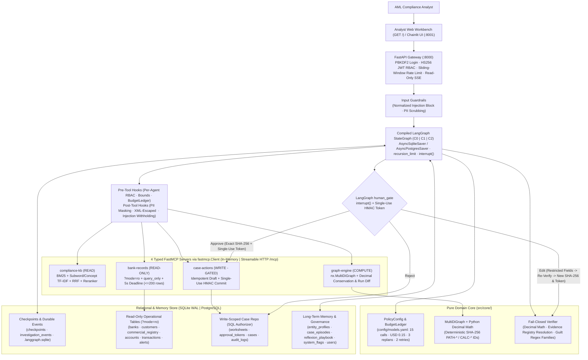
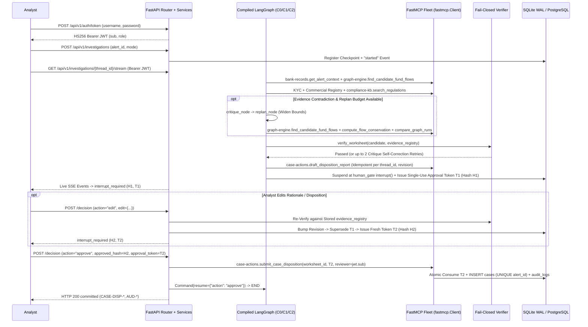

# AuditGuard — System, Component, Data-Flow & Database Architecture

> **Core Principle:** *The detector proposes. The agent investigates. The evidence supports. The human decides.*

---

## 1. High-Level System Architecture

---

## 2. Component Responsibilities & Separation of Concerns

| Layer | Module(s) | Responsibility | Enforced Invariant |
|---|---|---|---|
| **Pure Core** | [canonical.py](../src/core/canonical.py), [policy.py](../src/core/policy.py), [graph_math.py](../src/core/graph_math.py), [scoring.py](../src/core/scoring.py), [verifier.py](../src/core/verifier.py), [adapters.py](../src/core/adapters.py) | Framework-free `Decimal` types, canonical SHA-256 JSON hashing, `PolicyConfig` & thread-safe `BudgetLedger`, `nx.MultiDiGraph` path math, evidence-weighted rubric, and fail-closed worksheet verifier. | Zero `fastapi`, `fastmcp`, or LLM SDK imports; zero `float` currency math. |
| **Presentation & API** | [main.py](../src/api/main.py), [auth.py](../src/api/auth.py), [users.py](../src/api/users.py), [ratelimit.py](../src/api/ratelimit.py), `src/api/routes/*`, `src/api/services/*` | Thin modular routers (`ui`, `data`, `investigations`), PBKDF2 user auth, JWT role gates (`analyst`, `senior_reviewer`, `admin`), read-only SSE event subscriber, restricted edits, atomic approval, and transactional Right-to-Erasure. | `AUTH_REQUIRED=true` by default; `reviewer_id` derived strictly from `jwt.sub`; `500` errors masked with correlation IDs. |
| **LangGraph Orchestration** | [graph.py](../src/agent/graph.py), [nodes.py](../src/agent/nodes.py), [reasoning.py](../src/agent/reasoning.py), [drafting.py](../src/agent/drafting.py), [c0_fixed.py](../src/agent/c0_fixed.py), [c1_single.py](../src/agent/c1_single.py), [c2_multi.py](../src/agent/c2_multi.py) | Compiled `StateGraph` across `C0`, `C1`, and `C2` with deduplicating state reducers, `AsyncSqliteSaver`/`AsyncPostgresSaver`, structured LLM planning/hypotheses/critique, and native `interrupt()` before commit. | `recursion_limit` bound to `max_replans`; fail-closed critique retry loop (`<= 2`) before `human_gate`. |
| **Guardrails & FastMCP Fleet** | [guardrails.py](../src/guardrails/guardrails.py), [hooks.py](../src/guardrails/hooks.py), [client.py](../src/mcp_servers/client.py), `src/mcp_servers/*` | Pre/post tool enforcement and real `fastmcp.Client` transport (in-memory or `/mcp` streamable HTTP) across all 4 servers. | Read-only SQLite URI on `bank-records`; SQL authorizer write-scoping on `case-actions`; XML-escaped `<untrusted_data>` tags. |

---

## 3. End-to-End Investigation & Cryptographic Approval Lifecycle

