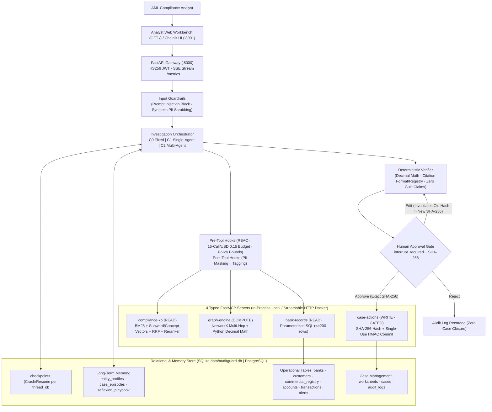

# AuditGuard — System, Component, Data-Flow & Database Architecture

> **Core Principle:** *The detector proposes. The agent investigates. The evidence supports. The human decides.*

---

## 1. High-Level System Architecture



---

## 2. Component Responsibilities & Separation of Concerns

| Layer | Module(s) | Responsibility | Security / Invariant |
|-------|-----------|----------------|----------------------|
| **Presentation & API** | [main.py](../src/api/main.py), [auth.py](../src/api/auth.py), [index.html](../src/ui/static/index.html), [app.py](../src/ui/app.py) | Serves Analyst Workbench (`/`), REST + SSE endpoints, HS256 JWT validation, Prometheus `/metrics`. | Blocks prompt injections (`422`), invalid JWTs (`401`), hash mismatches (`403`), and replays (`409`). |
| **Orchestration** | [c0_fixed.py](../src/agent/c0_fixed.py), [c1_single.py](../src/agent/c1_single.py), [c2_multi.py](../src/agent/c2_multi.py) | Executes Fixed (C0), Single-Agent ReAct + Replan (C1), and Supervisor + 4 Specialists (C2) workflows with node-level checkpointing. | Hard budget caps (`max_tool_calls=15`, `max_replans=3`, `max_cost_usd=0.15`). |
| **Enforcement & Verification** | [guardrails.py](../src/guardrails/guardrails.py), [hooks.py](../src/guardrails/hooks.py), [verifier.py](../src/guardrails/verifier.py) | Pre-tool RBAC & bounds validation; post-tool PII masking & `<untrusted_data>` wrapping; deterministic `Decimal` & citation verification. | `flow_tracer`, `benign_investigator`, and `regulatory_analyst` cannot invoke `case-actions`. |
| **FastMCP Tool Fleet** | [compliance_kb.py](../src/mcp_servers/compliance_kb.py), [graph_engine.py](../src/mcp_servers/graph_engine.py), [bank_records.py](../src/mcp_servers/bank_records.py), [case_actions.py](../src/mcp_servers/case_actions.py) | Read/compute/write-separated MCP servers invoked via [client.py](../src/mcp_servers/client.py). | Read-only parameterized SQL in `bank-records`; write-gated HMAC verification in `case-actions`. |
| **Relational Persistence & Memory** | [database.py](../src/db/database.py), [store.py](../src/memory/store.py) | Canonical SQLite (`data/auditguard.db`) / PostgreSQL DDL, durable checkpoints, and namespace-isolated LTM with `DELETE /api/v1/memory/{id}`. | Held-out cases (`eval/held_out/`) are physically isolated and never seeded into the operational database. |

---

## 3. End-to-End Investigation & Cryptographic Approval Lifecycle

```mermaid
sequenceDiagram
    participant Analyst
    participant API as FastAPI Gateway
    participant Agent as C1 / C2 Orchestrator
    participant MCP as FastMCP Servers
    participant Ver as Deterministic Verifier
    participant DB as SQLite / PostgreSQL

    Analyst->>API: POST /api/v1/investigations (alert_id="ALT-2026-0412", mode="c2_multi")
    API->>API: Input Guardrail Check + Create Checkpoint
    Analyst->>API: GET /api/v1/investigations/{thread_id}/stream
    API->>Agent: Execute Investigation
    Agent->>MCP: bank-records.get_alert_context("ALT-2026-0412")
    Agent->>MCP: graph-engine.find_candidate_fund_flows(window=7d, hops=3, tol=0.10)
    MCP-->>Agent: 3 Outbound Legs (INR 9,00,000), 0 Consolidation Hops
    Agent->>Agent: Critique Detects Missing Consolidation -> Replan (window=30d, hops=5, tol=0.20)
    Agent->>MCP: graph-engine.find_candidate_fund_flows(window=30d, hops=5, tol=0.20)
    MCP-->>Agent: Day-11 Consolidation Found (INR 8,28,000; 8.00% Fee Retained)
    Agent->>MCP: bank-records.get_kyc_profile + check_commercial_registry
    Agent->>MCP: compliance-kb.search_regulations (Hybrid BM25 + Vector + RRF + Rerank)
    Agent->>Ver: verify_worksheet(draft_payload)
    Ver-->>Agent: Verified + Canonical SHA-256 Hash H1
    Agent->>DB: Save Checkpoint (status="interrupt_required", payload_hash=H1)
    API-->>Analyst: SSE Event `interrupt_required` (Worksheet + Hash H1)
    alt Analyst Edits Worksheet
        Analyst->>API: POST /decision (action="edit", edited_fields={...})
        API->>Ver: Re-Verify Edited Payload -> Compute Fresh Hash H2
        API->>DB: Update Worksheet & Checkpoint (Invalidate H1 -> Save H2)
        API-->>Analyst: status="interrupt_required", payload_hash=H2
    end
    Analyst->>API: POST /decision (action="approve", approved_hash=H2)
    API->>MCP: case-actions.submit_case_disposition(worksheet_id, HMAC(H2))
    MCP->>DB: Atomic Commit to `cases` + `audit_logs` + Archive LTM Episode
    API-->>Analyst: HTTP 200 `committed` (Case Receipt ID)
```

---

## 4. Canonical Database Schema

Implemented in [database.py](../src/db/database.py) (SQLite local default `data/auditguard.db`) and [init_db.sql](../scripts/init_db.sql) (PostgreSQL Docker):

1. **`banks`** (`bank_id` PK, `bank_name`, `ifsc_prefix`)
2. **`customers`** (`customer_id` PK, `full_name`, `synthetic_pan_hash` UNIQUE, `kyc_tier`, `occupation`, `declared_annual_income_inr`, `risk_rating`, `onboarding_date`, `kyc_notes`)
3. **`commercial_registry`** (`registry_id` PK, `customer_id` FK, `entity_type`, `registration_number` UNIQUE, `status`, `registered_since`)
4. **`accounts`** (`account_id` PK, `bank_id` FK, `customer_id` FK, `account_type`, `status`, `opened_date`)
5. **`transactions`** (`txn_id` PK, `from_account_id` FK, `to_account_id` FK, `amount_inr` CHECK > 0, `txn_timestamp`, `channel`, `memo_text`) — indexed on `(from_account_id, txn_timestamp)` and `(to_account_id, txn_timestamp)`.
6. **`alerts`** (`alert_id` PK, `seed_account_id` FK, `triggered_at`, `rule_triggered`, `initial_amount_inr`, `network_accounts_json`, `status`)
7. **`worksheets`** (`worksheet_id` PK, `alert_id`, `content_json`, `payload_hash`, `status`, `reviewer_id`, `reviewer_decision`, `reviewer_notes`, `created_at`, `updated_at`)
8. **`cases`** (`case_id` PK, `alert_id` UNIQUE, `worksheet_id`, `disposition`, `worksheet_json`, `payload_hash`, `approver_id`, `committed_at`)
9. **`audit_logs`** (`log_id` PK AUTOINCREMENT, `case_id`, `thread_id`, `event_type`, `actor`, `payload_hash`, `details_json`, `created_at`) — indexed on `thread_id`.
10. **`checkpoints`** (`thread_id` PK, `alert_id`, `mode`, `current_node`, `status`, `worksheet_id`, `payload_hash`, `state_json`, `updated_at`)
11. **`entity_profiles`**, **`case_episodes`**, **`reflexion_playbook`**, **`system_flags`** (Long-Term Memory & Playbook Freeze state).
