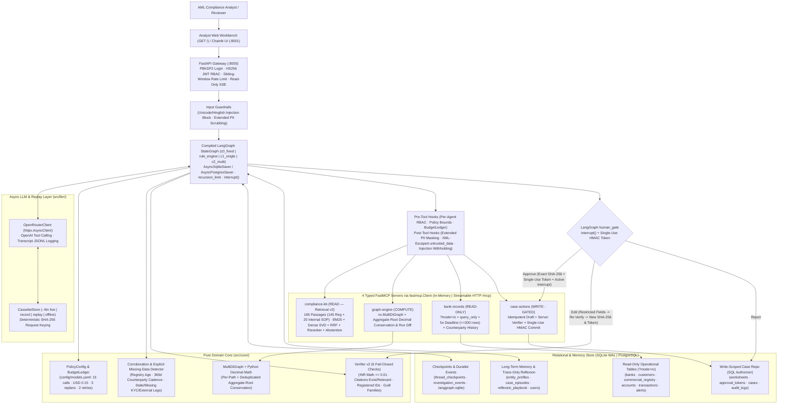
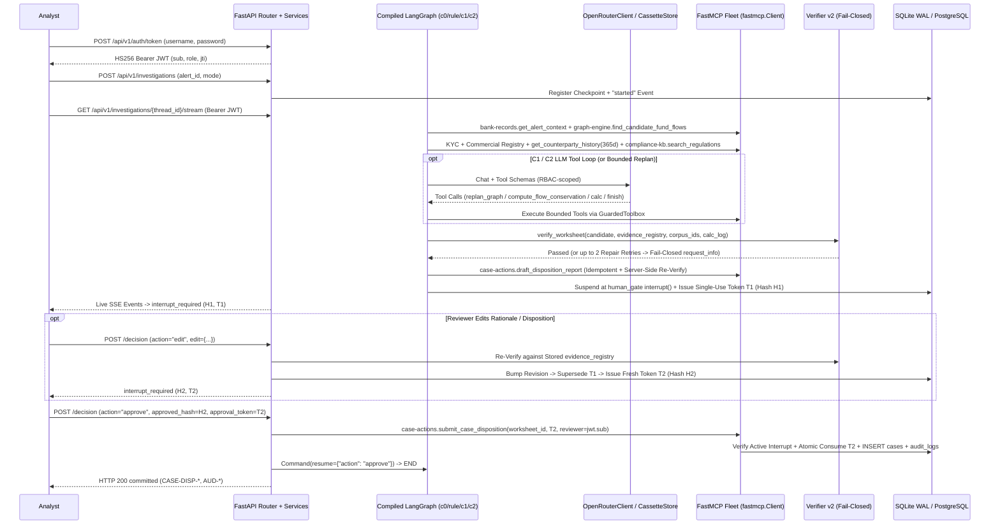

# AuditGuard v3 — System, Component, Data-Flow & Database Architecture

> **Core Principle:** *The detector proposes. The agent investigates. The evidence supports. The human decides.*

---

## 1. High-Level System Architecture

---

## 2. Component Responsibilities & Separation of Concerns

| Layer | Module(s) | Responsibility | Enforced Invariant |
|---|---|---|---|
| **Pure Core** | [canonical.py](../src/core/canonical.py), [policy.py](../src/core/policy.py), [graph_math.py](../src/core/graph_math.py), [corroboration.py](../src/core/corroboration.py), [scoring.py](../src/core/scoring.py), [verifier.py](../src/core/verifier.py), [adapters.py](../src/core/adapters.py) | Framework-free `Decimal` types, canonical SHA-256 hashing, `PolicyConfig` & thread-safe `BudgetLedger`, `nx.MultiDiGraph` per-path & deduplicated aggregate-root flow math, registration corroboration & explicit missing-data detection, and Verifier v2 (6 named checks). | Zero `fastapi`, `fastmcp`, or LLM SDK imports; zero `float` currency math; INR grounding within ₹0.01. |
| **Async LLM & Replay** | [client.py](../src/llm/client.py), [replay.py](../src/llm/replay.py), [schemas.py](../src/llm/schemas.py) | Async OpenRouter tool-calling client with PII-redacted transcript logging (`runs/<run_id>/transcripts.jsonl`) and deterministic SHA-256 `CassetteStore` for keyless CI replay. | Every LLM call logs model, tokens, USD cost, and latency; `--llm replay` fails closed on cassette miss. |
| **Agent Orchestration** | [graph.py](../src/agent/graph.py), [loop.py](../src/agent/loop.py), [c2_loop.py](../src/agent/c2_loop.py), [tools.py](../src/agent/tools.py), [nodes.py](../src/agent/nodes.py), [gathering.py](../src/agent/gathering.py), [c0_fixed.py](../src/agent/c0_fixed.py), [rule_engine.py](../src/agent/rule_engine.py) | Compiled LangGraph `StateGraph` across `c0_fixed`, `rule_engine`, `c1_single`, and `c2_multi`; local `calc`, `replan_graph`, and `finish` tools; case-specific regulatory query formulation; native `interrupt()` before commit. | `recursion_limit` bound to `max_replans`; fail-closed verifier repair retries (`<= 2`) before `human_gate`; forged-registry never auto-closes below corroboration threshold. |
| **Guardrails & FastMCP Fleet** | [guardrails.py](../src/guardrails/guardrails.py), [hooks.py](../src/guardrails/hooks.py), [client.py](../src/mcp_servers/client.py), [compliance_kb.py](../src/mcp_servers/compliance_kb.py), [graph_engine.py](../src/mcp_servers/graph_engine.py), [bank_records.py](../src/mcp_servers/bank_records.py), [case_actions.py](../src/mcp_servers/case_actions.py) | Unicode/homoglyph/multilingual injection detection, extended Indian PII masking, per-agent RBAC allow-lists, Retrieval v2 (165 passages, 4 pipelines, abstention, `source_type` filter), and 4 typed FastMCP servers. | Read-only SQLite URI on `bank-records`; SQL write-scope authorizer on `case-actions`; XML-escaped `<untrusted_data>` tags; `eval/golden_v2/held_out/` inaccessible to runtime code. |
| **Presentation & API** | [main.py](../src/api/main.py), [auth.py](../src/api/auth.py), [users.py](../src/api/users.py), [ratelimit.py](../src/api/ratelimit.py), `src/api/routes/*`, `src/api/services/*` | Modular FastAPI routers, PBKDF2 login, HS256 JWT RBAC (`analyst`, `senior_reviewer`, `admin`) with `jti` logout revocation, read-only SSE replay, restricted edits, atomic single-winner approval (`409 INTERRUPT_NOT_ACTIVE` fail-closed), and transactional Right-to-Erasure. | `AUTH_REQUIRED=true` by default; `reviewer_id` derived strictly from `jwt.sub`; `/metrics` bearer-token protected. |
| **Evaluation, Judge & Reporting** | [run_eval.py](../eval/run_eval.py), [red_team_runner.py](../eval/red_team_runner.py), [retrieval_eval.py](../eval/retrieval_eval.py), [judge.py](../eval/judge.py), [calibration.py](../eval/calibration.py), [stats.py](../eval/stats.py), [verify_gates.py](../eval/verify_gates.py), [report.py](../eval/report.py) | YAML-honoured concurrent E1–E4 harness, Wilson & 10k cluster-bootstrap 95% CIs, exact McNemar, anti-shortcut baselines, cross-family Gemini judge (`G1`–`G7`), CI zero-drift & smoke-replay gates, and programmatic `docs/evaluation_report.md` generation from `summary.json` only. | Held-out gold labels stripped before passing cases to agents; missing YAML metrics raise `NotImplementedError` / `VerificationGateError`. |

---

## 3. End-to-End Investigation & Cryptographic Approval Lifecycle

